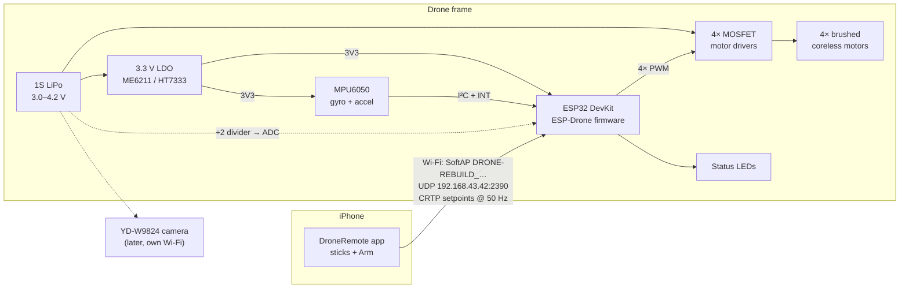
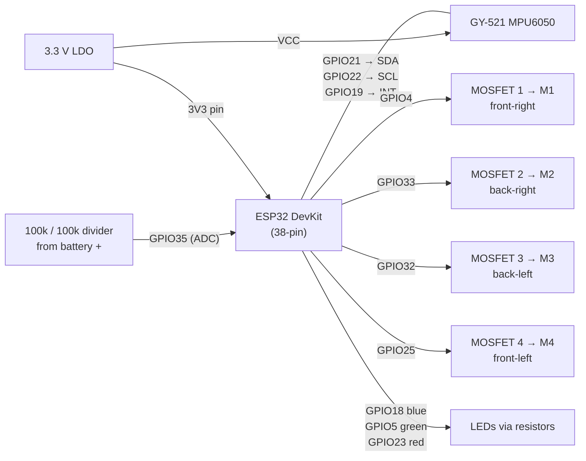
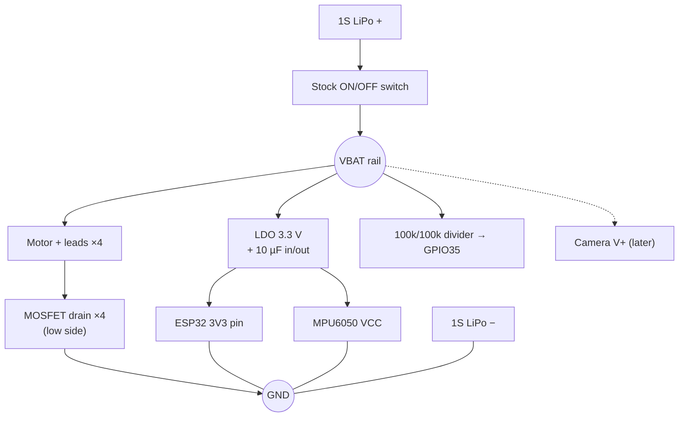
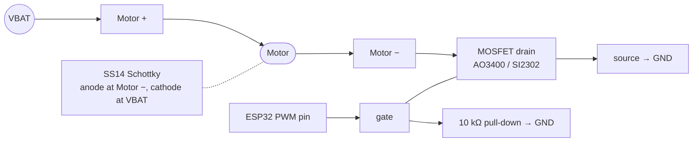
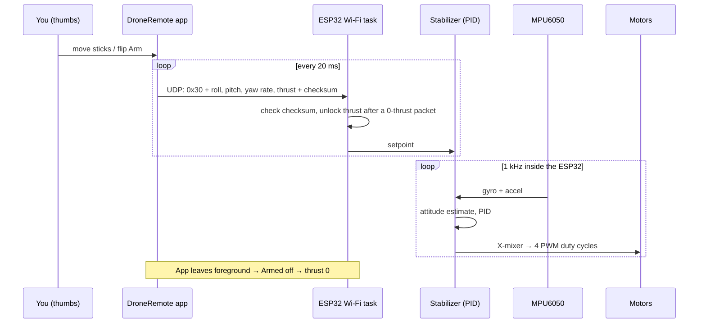

# How it all fits together

Diagrams render on GitHub (Mermaid). Pin numbers are ESP-Drone's `TARGET_ESPLANE_V1`
defaults (`firmware/esp-drone/main/Kconfig.projbuild`). Nothing here is bench-verified yet.

## 1. System overview



## 2. Wiring (ESP32 pin map)



All grounds are common: battery −, LDO, ESP32 GND, MPU6050 GND, MOSFET sources.

Leave the DevKit's **5V/VIN pin unconnected**; power enters only at 3V3 from the LDO
(see [ESP32 dev board](../wiki/hardware/esp32-devkit.md)).

## 3. Power



## 4. One motor channel (×4)



The pull-down keeps motors off while the ESP32 boots; the diode absorbs the motor's
voltage spike when the MOSFET turns off.

## 5. Motor layout (top view, nose up)

```
        FRONT
   M4 ●       ● M1
      \       /
        [ESP]
      /       \
   M3 ●       ● M2
        BACK
```

ESP-Drone uses X mode (`power_distribution_stock.c`). Diagonal pairs M1/M3 and M2/M4
spin the same way, and the two pairs spin opposite to each other. The stock lead colours
already split the motors this way: red/blue on one diagonal, white/black on the other.
Check each motor's direction on the bench (props off) and swap its two leads if it's wrong.

## 6. One control cycle


